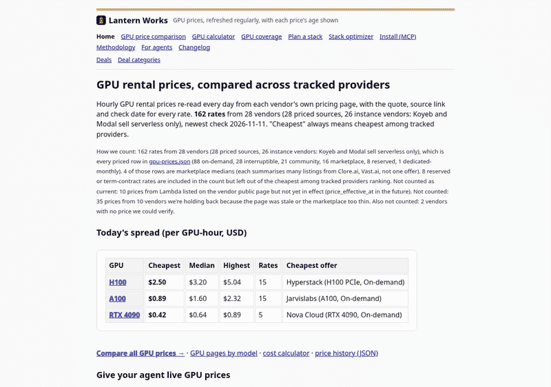

# Lantern Works GPU Prices: MCP server for cloud GPU rental prices

Free, read-only MCP server that compares live cloud GPU rental prices (H100, H200, A100, L40S, RTX 4090/5090 and more) across tracked providers, cheapest first, with each price's vendor source page and check time. No API key.

[](https://pypi.org/project/lantern-works-deals-mcp/) [](https://pypi.org/project/lantern-works-deals-mcp/) [](LICENSE) [](https://registry.modelcontextprotocol.io/v0/servers?search=lantern-works-deals) [](LICENSE-DATA)

[](https://cursor.com/en/install-mcp?name=lantern-works-gpu-prices&config=eyJ1cmwiOiJodHRwczovL2xhbnRlcm4td29ya3MtbWNwLmxhbnRlcm4td29ya3Mud29ya2Vycy5kZXYvbWNwP3JlZj1yZWFkbWUtY3Vyc29yLWJ1dHRvbiJ9) [](https://vscode.dev/redirect/mcp/install?name=lantern-works-gpu-prices&config=%7B%22type%22%3A%22http%22%2C%22url%22%3A%22https%3A//lantern-works-mcp.lantern-works.workers.dev/mcp%3Fref%3Dreadme-vscode-button%22%7D)

**Connect in one line**

- Hosted, no install (Streamable HTTP): `https://lantern-works-mcp.lantern-works.workers.dev/mcp?ref=readme`
- Local (stdio, Python 3.10+): `uvx lantern-works-deals-mcp`

Then ask: *"What's the cheapest H100 to rent for 100 hours? Show sources."*



[thelanternworks.com](https://thelanternworks.com/?ref=readme) · [Receipts](https://lantern-works-mcp.lantern-works.workers.dev/receipts/?ref=receipts-readme)

## Connect your client

Hosted URL: `https://lantern-works-mcp.lantern-works.workers.dev/mcp` (`?ref=` only tags which snippet was used). Local command: `uvx lantern-works-deals-mcp` (or `pip install lantern-works-deals-mcp`, then `lantern-works-deals-mcp`).

**Claude Code**
```bash
claude mcp add --transport http lantern-works-gpu-prices "https://lantern-works-mcp.lantern-works.workers.dev/mcp?ref=readme-claude-code"
# or local stdio:
claude mcp add lantern-works-deals -- uvx lantern-works-deals-mcp
```

**Claude Desktop**: `claude_desktop_config.json` (Settings → Developer → Edit Config). Or add the hosted URL under Settings → Connectors → Add custom connector: `https://lantern-works-mcp.lantern-works.workers.dev/mcp?ref=readme-claude-desktop`
```json
{ "mcpServers": { "lantern-works-deals": { "command": "uvx", "args": ["lantern-works-deals-mcp"] } } }
```

**Cursor**: `~/.cursor/mcp.json` or `.cursor/mcp.json` (or use the button above)
```json
{ "mcpServers": { "lantern-works-gpu-prices": { "url": "https://lantern-works-mcp.lantern-works.workers.dev/mcp?ref=readme-cursor" } } }
```

**VS Code (GitHub Copilot agent mode)**: `.vscode/mcp.json`
```json
{ "servers": { "lantern-works-gpu-prices": { "type": "http", "url": "https://lantern-works-mcp.lantern-works.workers.dev/mcp?ref=readme-vscode" } } }
```

**Windsurf (now Devin Desktop)**: `~/.config/devin/mcp_config.json` (older Windsurf builds: `~/.codeium/windsurf/mcp_config.json`)
```json
{ "mcpServers": { "lantern-works-gpu-prices": { "serverUrl": "https://lantern-works-mcp.lantern-works.workers.dev/mcp?ref=readme-windsurf" } } }
```

**Cline**: `cline_mcp_settings.json` (MCP Servers → Configure)
```json
{ "mcpServers": { "lantern-works-gpu-prices": { "type": "streamableHttp", "url": "https://lantern-works-mcp.lantern-works.workers.dev/mcp?ref=readme-cline" } } }
```

**OpenAI Codex CLI**
```bash
codex mcp add lantern-works-deals -- uvx lantern-works-deals-mcp
```

**Any other MCP client**: stdio `uvx lantern-works-deals-mcp`, or Streamable HTTP `https://lantern-works-mcp.lantern-works.workers.dev/mcp?ref=readme-other`. More clients: https://thelanternworks.com/install/?ref=readme

## Get your first quote — no installation or API key

Python 3.10+, standard library only. [Read the example](examples/first_quote.py), then download and run it:

```sh
curl --fail --location https://raw.githubusercontent.com/connormatthewdouglas/agent-work-stack-deals/main/examples/first_quote.py --output first_quote.py
python3 first_quote.py --gpu 'H100 SXM' --hours 100 --ref readme
```

This calls the public hosted MCP: three on-demand rates checked within 24 hours, then a 100-hour, one-GPU compute estimate with sources, assumptions, missing costs and a receipt. It creates no purchase or watch. Use `--qa` for internal tests.

[Client setup](https://thelanternworks.com/install/?ref=readme) · [Quickstart](https://thelanternworks.com/quickstart/?ref=readme) · [Agent manifest](https://thelanternworks.com/agent.json) · [Small per-model JSON feeds](https://thelanternworks.com/api/v1/gpu/index.json) · [Add this to your README or dataset](docs/INTEGRATING.md)

- **GPU prices:** [thelanternworks.com](https://thelanternworks.com/?ref=readme) · [/gpu/](https://thelanternworks.com/gpu/?ref=readme) · JSON [api/v1/gpu-prices.json](https://thelanternworks.com/api/v1/gpu-prices.json) · history [api/v1/gpu-prices/history.json](https://thelanternworks.com/api/v1/gpu-prices/history.json) · what moved since yesterday [api/v1/gpu-price-changes.json](https://thelanternworks.com/api/v1/gpu-price-changes.json) ([RSS](https://thelanternworks.com/api/v1/gpu-price-changes.xml))
- **GPU coverage:** which GPU models each vendor is tracked for (in stock, priced, not listed): [/coverage/](https://thelanternworks.com/coverage/?ref=readme) · JSON [api/v1/coverage.json](https://thelanternworks.com/api/v1/coverage.json)
- **Deals directory:** [thelanternworks.com/deals/](https://thelanternworks.com/deals/?ref=readme) · [About](https://thelanternworks.com/lanternworks/?ref=readme)
- **Agent feed (JSON, no auth):** [thelanternworks.com/api/v1/deals.json](https://thelanternworks.com/api/v1/deals.json) (same bytes as `/deals.json`) · mirror: [gist](https://gist.githubusercontent.com/connormatthewdouglas/ab5c3a8dceaf396d8f0c631913433a5e/raw/deals.json)
- **Stack pricing:** [api/v1/stack-pricing.json](https://thelanternworks.com/api/v1/stack-pricing.json)
- **Query CLI:** `python3 query_deals.py --category unblock --max-price 20` (filter contract: [USAGE.md](USAGE.md))
- **MCP test summaries:** [Receipts](https://lantern-works-mcp.lantern-works.workers.dev/receipts/?ref=receipts-readme) · [JSON](https://lantern-works-mcp.lantern-works.workers.dev/api/v1/receipts.json?ref=receipts-readme) (dated findings, separate from job-price receipts)

Contact: [lanternworks@agentmail.to](mailto:lanternworks@agentmail.to)

## MCP server (v0.6.6, read-only, stdio)

Free, read-only, no API key. Package [`lantern-works-deals-mcp`](https://pypi.org/project/lantern-works-deals-mcp/) on PyPI; MCP Registry name `io.github.connormatthewdouglas/lantern-works-deals`. Built on the official Python MCP SDK.

Tool counts: **10** in the local package (stdio, below); **17** on the hosted endpoint (the same 10 plus `create_watch_key`, `watch_price`, `list_watches`, `delete_watch`, and the poll-only price alerts `create_alert`, `check_alerts`, `delete_alert`).

The full tool contracts, eligibility and stale-price rules, hosted endpoint, alert delivery, throughput data, and the feed contract and deploy gate are in [docs/CONTRACT.md](docs/CONTRACT.md). Arguments, errors, data sources and tests: [mcp_server/README.md](mcp_server/README.md).

## Tools (9, read-only)

| Tool | What it does |
|---|---|
| `compare_gpu_prices` | Hourly rental prices for a GPU model across tracked providers, cheapest first. When a result includes `availability_rate_7d`, `window_days` is the planned window and `observed_hours` is the actual coverage (`coverage_note` when coverage is shorter). The output also carries file-level `availability_window_summary` (no-window counts by reason, plus when current windows began) and `content_build_id`. |
| `get_price_changes` | GPU price moves among tracked providers, newest first. |
| `get_price_trend` | 7-day and 30-day price trend for one `rate_id` (existing snapshots; never from stale/held/sold_out/no_source rows). |
| `optimize_stack` | Cheapest tracked plan per usage line, with sources. |
| `optimize_agent_stack` | Cheapest cited option per component from a plain-text agent description. |
| `estimate_job_cost` | Cost of one GPU job among tracked providers, cheapest first. |
| `rebuild_quote` | Reopen a past quote and revalidate it against today's feed. |
| `search_deals` | Search the deals feed by text, category, offer type, price and tags. |
| `compare_deals` | Compare 2-5 deals by id, best customer value first. |
| `get_deal` | Return the full public record for one deal id. |

Keywords: MCP server, Model Context Protocol, GPU prices, cloud GPU pricing, GPU rental price comparison, H100 / H200 / A100 / L40S / RTX 4090 / RTX 5090 hourly price, GPU cost estimate, price history, AI infrastructure costs, Claude, Cursor, VS Code Copilot, Windsurf, Cline.

Quickstart: ask for `compare_gpu_prices(gpu="H100")`, then the next day call `get_price_changes(since="<data_checked_at date>")` to see what moved. The feed rebuilds once a day (about 10:23 UTC). Every price shows its own `checked_at`/`verified_at`, and `compare_gpu_prices` and `optimize_agent_stack` return `data_checked_at` and `next_refresh_utc`.

## Run locally / Docker / privacy

Docker: `docker build -t lantern-works-deals-mcp . && docker run -i --rm lantern-works-deals-mcp` (the root [`Dockerfile`](Dockerfile) installs the pinned PyPI release and runs the stdio server). Without uv: `pip install lantern-works-deals-mcp`, then use `"command": "lantern-works-deals-mcp"`. Other clients: https://thelanternworks.com/install/?ref=readme · Skill: `npx skills add connormatthewdouglas/agent-work-stack-deals`.

Telemetry is **off by default**. `LANTERN_TELEMETRY=1` opts in to an anonymous daily count of tool calls. What is sent: tool name (`t`), package version (`v`), UTC day (`d`), call count (`n`), a random install id (`install_id`) stored locally at `~/.config/lantern-works/install_id` (or `$XDG_CONFIG_HOME/lantern-works/install_id`; deletable), and `ref` from `LANTERN_REF` (or `none`). No arguments, IPs, names or hostnames. See [PRIVACY.md](PRIVACY.md).

Hosted endpoint (no install): `https://lantern-works-mcp.lantern-works.workers.dev/mcp?ref=readme`. Privacy and caller-count detail: [docs/CONTRACT.md](docs/CONTRACT.md), [PRIVACY.md](PRIVACY.md) and [/privacy/](https://thelanternworks.com/privacy/).


Demo (live data, 2026-10-28): the MCP server answers "cheapest H100 for 100 hours?". It shows 100-hour totals for the cheapest, next and most expensive tracked rates, each with its source and check time, and labels referral links. Recording: [docs/demo/cheapest-h100-100h.cast](docs/demo/cheapest-h100-100h.cast) · script: [docs/demo/demo.py](docs/demo/demo.py).

Framework examples: [LangGraph](examples/langgraph-cheapest-h100/) (cheapest H100), [CrewAI](examples/crewai-cheapest-gpu/) and [OpenAI Agents SDK](examples/openai-agents-cheapest-gpu/) (cheapest GPU for a described job), [Stack optimizer](examples/stack-optimizer/) (describe your agent, get the cheapest cited stack via `optimize_agent_stack`), [GPU price watcher](examples/gpu-price-watcher/) (what moved since a date via `get_price_changes`, cron-ready), [GPU price monitor](examples/gpu-price-monitor/) (price-drop alerts from the history API). All examples: [examples/](examples/). Some tool results include referral links (`affiliate: true`).

## Report a wrong price

See a price that doesn't match the vendor's page, or an offer you can't rent? [Open a wrong-price report](https://github.com/connormatthewdouglas/agent-work-stack-deals/issues/new?template=wrong-price.yml). Agents can prefill it from a feed row; see [docs/REPORT-WRONG-PRICE.md](docs/REPORT-WRONG-PRICE.md).

## License

- Code: MIT, see [LICENSE](LICENSE).
- Field reference for `canonical_model`, `form_factor`, `availability_rate_7d` (`window_days` = planned window, `observed_hours` = actual coverage), file-level `availability_window_summary`, and `content_build_id` in `gpu-prices.json`: [docs/GPU-PRICES-FIELDS.md](docs/GPU-PRICES-FIELDS.md).
- Price and deal data (`deals.json`, `api/v1/*.json` including `gpu-prices.json`, the price history and change feed, `data/gpu_pricing/`): [CC BY 4.0](https://creativecommons.org/licenses/by/4.0/), see [LICENSE-DATA](LICENSE-DATA). Attribution: "Lantern Works" with a link to https://thelanternworks.com. Every JSON feed carries these terms in its `license` field.
