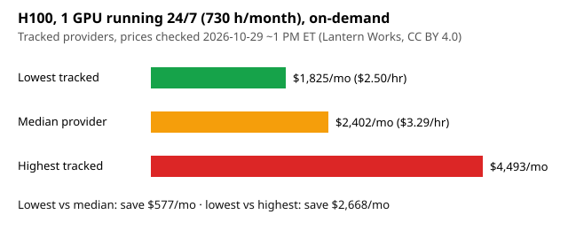

# Dollar-savings demo: H100, 1 GPU, 24/7

A real comparison from the Lantern Works GPU price API ([api/v1/gpu-prices.json](https://thelanternworks.com/api/v1/gpu-prices.json)), on-demand H100 rates among **tracked providers only**, prices checked 2026-10-29 between 12:59 and 1:01 PM ET. 1 GPU × 730 h/month.



| Case | Provider (rate) | $/GPU-hr | $/month (730 h) |
|---|---|---|---|
| Lowest tracked | Hyperstack, H100 PCIe ([source](https://www.hyperstack.cloud/gpu-pricing)) | $2.50 | $1,825.00 |
| Median of 9 providers' cheapest H100 | (Lantern Works GPU Price Index) | $3.29 | $2,401.70 |
| Highest tracked | CoreWeave, HGX H100 8-GPU node, per GPU ([source](https://www.coreweave.com/pricing)) | $6.155 | $4,493.15 |

- Lowest vs median: **$576.70/month** (~$6,920/year) saved.
- Lowest vs highest: **$2,668.15/month** saved.

Caveats: H100 PCIe, SXM and 8-GPU HGX nodes are different products (interconnect, bundled CPU/RAM/storage); egress, storage and minimum commitments are not included. Prices change daily; re-run before deciding.

Reproduce:

```bash
curl -s https://thelanternworks.com/api/v1/gpu-prices.json | python3 -c '
import json,sys,statistics
r=[x for x in json.load(sys.stdin)["rates"] if x["gpu"].startswith("H100") and x["tier_class"]=="on-demand" and x["price_status"]=="listed"]
best={}
for x in r: best[x["advertiser"]]=min(best.get(x["advertiser"],9e9),x["hourly_equiv_usd"])
v=sorted(best.values()); lo,med=v[0],statistics.median(v)
print(f"lowest ${lo}/hr, median ${med}/hr, save ${(med-lo)*730:,.2f}/month at 1 GPU 24/7")'
```

Or via MCP: `compare_gpu_prices(gpu="H100")`. Some providers in the feed have referral links with Lantern Works (not Hyperstack or CoreWeave); affiliate status does not affect ranking. Data CC BY 4.0, attribute "Lantern Works".
